# Proyecto 1 · Mi web en AWS: Librería Tinta

**Alumno:** Bradan Espla · 2º DAW · Implantación a la Nube Pública  
**Entorno:** AWS Academy Learner Lab · región `us-east-1`

🎥 **Vídeo:** [enlace al vídeo](PEGAR_ENLACE_DEL_VIDEO)

---

## 1. Arquitectura

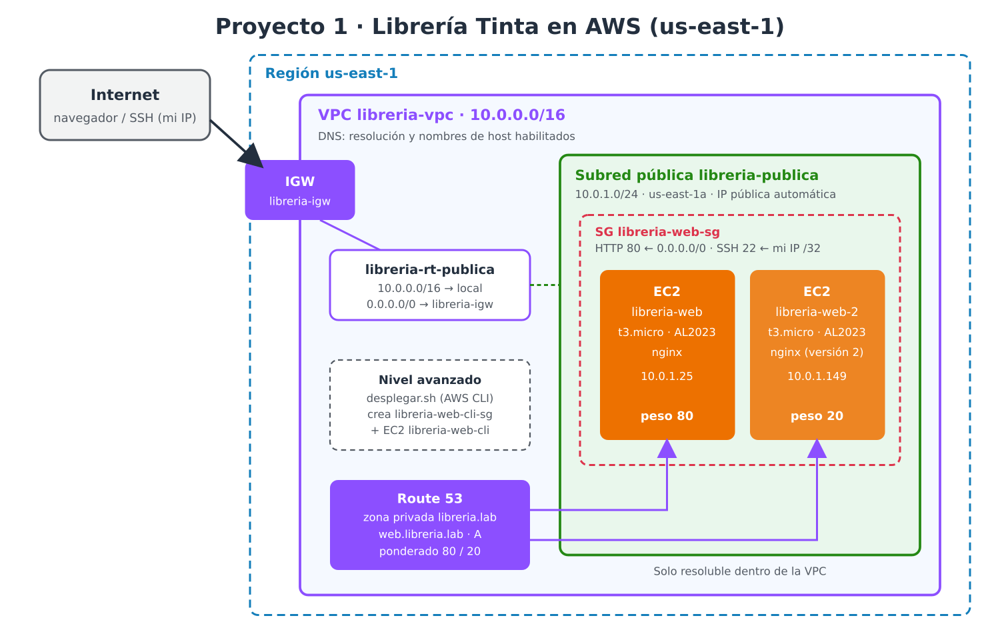

Una VPC propia (`libreria-vpc`, 10.0.0.0/16) con una subred pública (`libreria-publica`, 10.0.1.0/24, us-east-1a). La subred sale a Internet por la Internet Gateway `libreria-igw` gracias a la tabla de rutas `libreria-rt-publica`. Dentro están los servidores web nginx, protegidos por el grupo de seguridad `libreria-web-sg`. En el nivel medio, una zona privada de Route 53 (`libreria.lab`) reparte el nombre `web.libreria.lab` entre los dos servidores con pesos 80/20.

## 2. Nivel básico

### B1. Red

| Recurso | Nombre | ID | Configuración |
|---|---|---|---|
| VPC | libreria-vpc | vpc-0e08a295ca13fc186 | 10.0.0.0/16, resolución DNS y nombres de host DNS habilitados |
| Subred pública | libreria-publica | subnet-087af7414c862827c | 10.0.1.0/24, us-east-1a, asignación automática de IPv4 pública |
| Internet Gateway | libreria-igw | igw-0c0f6280237cc4d82 | Conectada a libreria-vpc |
| Tabla de rutas | libreria-rt-publica | rtb-08e9db83ccd4c530f | 0.0.0.0/0 → libreria-igw, asociada a libreria-publica |

Cada recurso se ha creado por separado, sin el asistente «VPC y más».

**VPC**
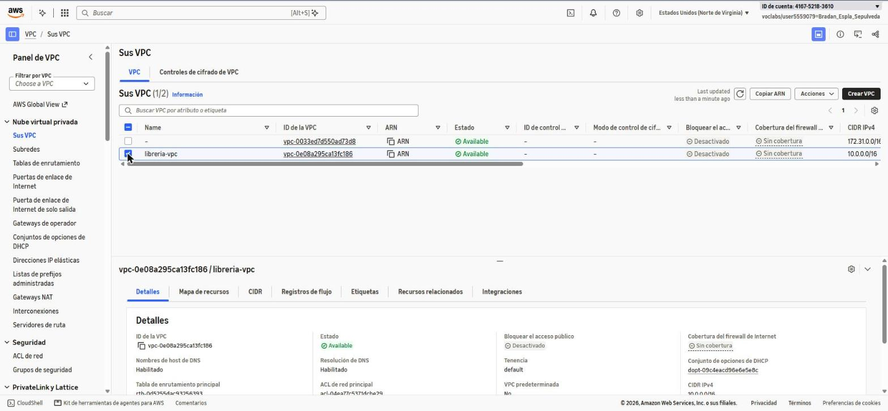

**Subred** (se ve la zona us-east-1a y «Asignación automática de la dirección IPv4 pública: Sí»)
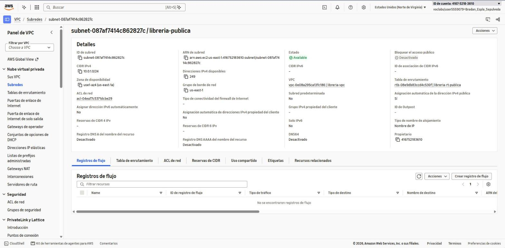

**Internet Gateway**
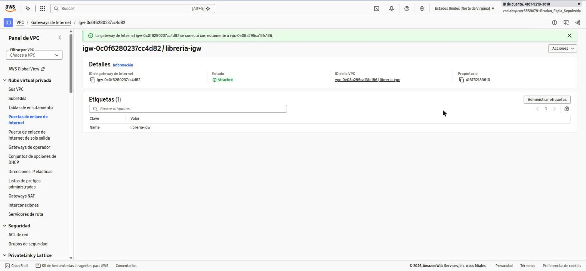

**Tabla de rutas**
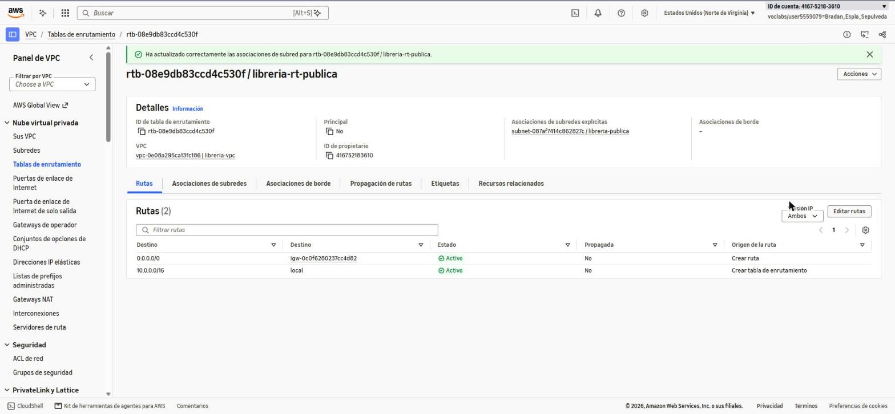

### B2. Seguridad

Grupo `libreria-web-sg` (sg-054e08e5f9269b0b5) en libreria-vpc:

| Tipo | Puerto | Origen | ¿Por qué? |
|---|---|---|---|
| HTTP | 80 | 0.0.0.0/0 | Cualquiera debe poder ver la web |
| SSH | 22 | 213.0.87.102/32 (Mi IP) | Solo yo debo poder administrar el servidor |
| SSH | 22 | 37.29.159.144/32 (Mi IP con datos móviles) | La wifi bloquea el puerto 22, así que para conectarme por SSH uso los datos del móvil |

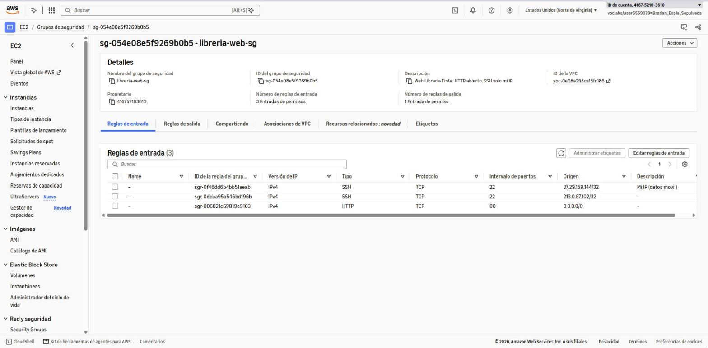

### B3. Servidor web

Instancia `libreria-web` (i-0b60bb482b301f78b): Amazon Linux 2023, t3.micro, clave `vockey`, en libreria-vpc / libreria-publica / libreria-web-sg. Etiquetas `Proyecto=P1` y `Alumno=Bradan Espla`. Datos de usuario: [`scripts/user-data1.sh`](scripts/user-data1.sh), que instala nginx y pone la página de la librería con horario, dirección y recomendación del mes.

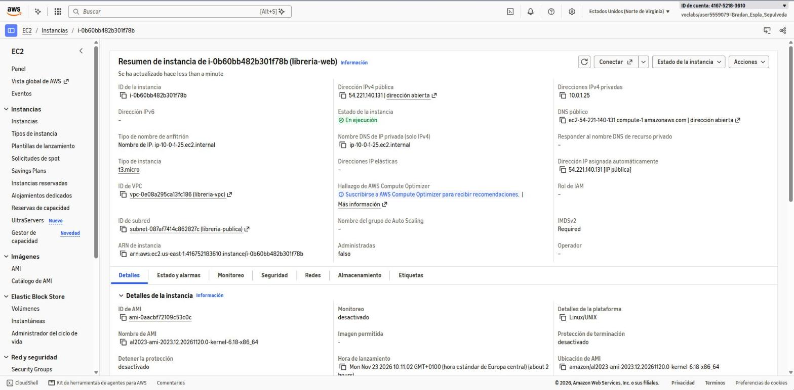
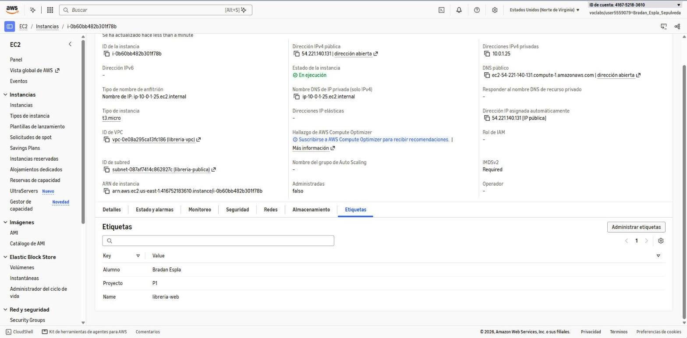

**Web funcionando** (http://54.221.140.131):
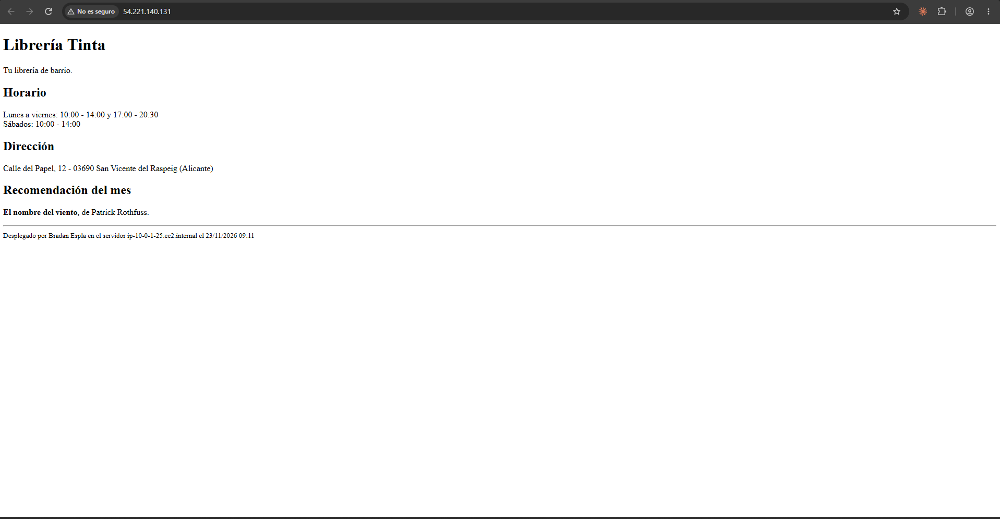

### ¿Por qué la subred es pública y por qué el SSH solo se abre a mi IP?

La subred es pública porque su tabla de rutas manda todo el tráfico que no es de la VPC (0.0.0.0/0) a la Internet Gateway y además asigna IP pública a las instancias; sin esas dos cosas nadie podría llegar a la web desde Internet. El SSH solo se abre a mi IP (/32) porque da control total del servidor. Si estuviera abierto a 0.0.0.0/0, cualquiera podría intentar entrar (por ejemplo, con ataques de fuerza bruta), mientras que el puerto 80 sí debe estar abierto porque la web es pública.

### B4. Presupuesto

- **Estimación compartida:** https://calculator.aws/#/estimate?id=c86cf8797b2034f2680e2b9e37f624cc01f9cc81
- **Coste mensual (1 × t3.micro bajo demanda 24/7 en us-east-1 + 8 GB gp3): 8,23 USD/mes** (7,59 USD de instancia a 0,0104 USD/h y 0,64 USD de disco), unos 98,76 USD al año.
- **Cómo abaratarlo:** encender la web solo en el horario de la librería en vez de 24/7, o comprometer uso con un Savings Plan. Con un Compute Savings Plan a 3 años la calculadora baja la instancia a 3,80 USD/mes. Para una página estática como esta también se podría servir desde S3, que sería mucho más barato que una EC2.

Nota: la calculadora no incluye la IPv4 pública, que AWS cobra aparte (0,005 USD/h, unos 3,65 USD/mes por IP).

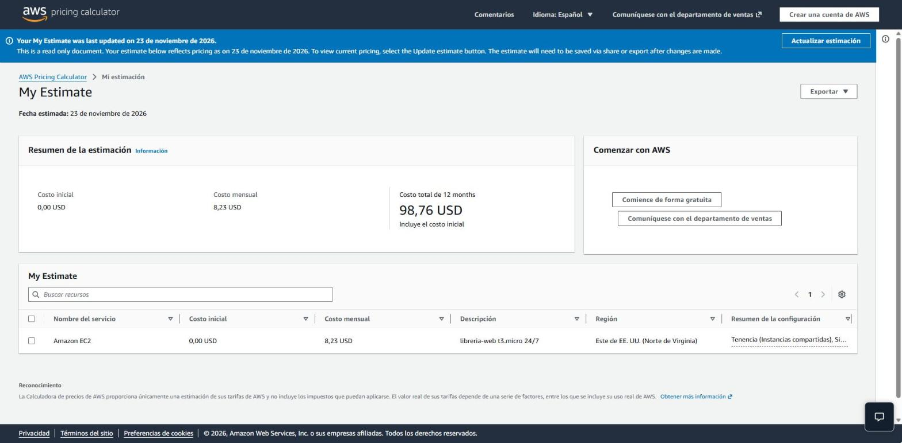

## 3. Nivel medio: DNS ponderado con Route 53

### Servidores

| Servidor | Nombre | ID | IP privada | IP pública | Peso |
|---|---|---|---|---|---|
| 1 | libreria-web | i-0b60bb482b301f78b | 10.0.1.25 | 54.221.140.131 | 80 |
| 2 | libreria-web-2 | i-00273898107d7ce20 | 10.0.1.149 | 18.212.242.103 | 20 |

El servidor 2 se lanzó con «Lanzar más como esta» (misma VPC, subred y grupo de seguridad) y con [`scripts/user-data2.sh`](scripts/user-data2.sh), que pone fondo amarillo y el texto «SERVIDOR 2» para distinguirlo.

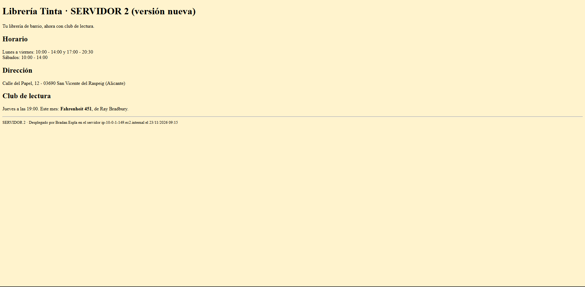

### Configuración

- La VPC tiene activadas *Resolución de DNS* y *Nombres de host DNS* (se ve en la captura de B1).
- Zona alojada **privada** `libreria.lab` asociada a `libreria-vpc`.
- Dos registros A `web.libreria.lab` con TTL 10, enrutamiento **ponderado**: `servidor1` → 10.0.1.25 (peso 80) y `servidor2` → 10.0.1.149 (peso 20).

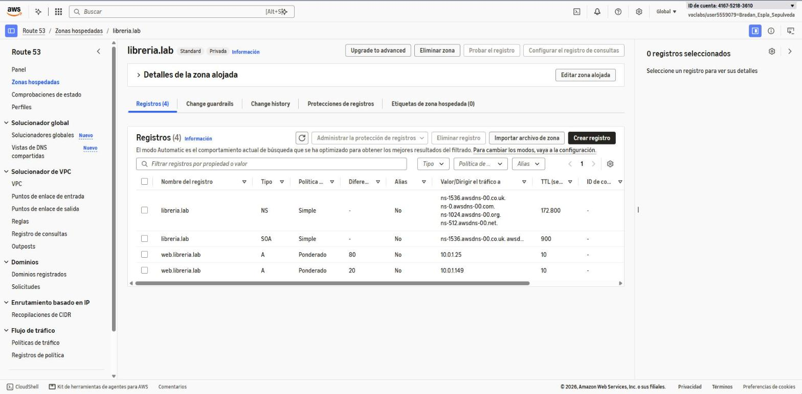

### Comprobación desde dentro de la VPC (SSH al servidor 1)

La wifi desde la que trabajo bloquea el puerto 22 de salida: `Test-NetConnection` da `TcpTestSucceeded : True` en el 80 y `False` en el 22. Por eso la prueba se hizo con **EC2 Instance Connect** desde la consola. Para ello se añadió **temporalmente** una regla SSH desde el rango de EC2 Instance Connect de us-east-1 (18.206.107.24/29). Al terminar se borró, y el grupo de seguridad quedó otra vez con SSH solo desde mi IP.

```bash
sudo dnf install -y bind-utils
dig web.libreria.lab
for i in $(seq 1 20); do curl -s http://web.libreria.lab | grep -q 'SERVIDOR 2' && echo "$i -> servidor 2" || echo "$i -> servidor 1"; sleep 1; done
for i in $(seq 1 100); do dig +short web.libreria.lab; sleep 0.5; done | sort | uniq -c
```

**`dig`**: `web.libreria.lab` se resuelve a una IP privada (aquí 10.0.1.25) usando el DNS de la VPC (10.0.0.2).
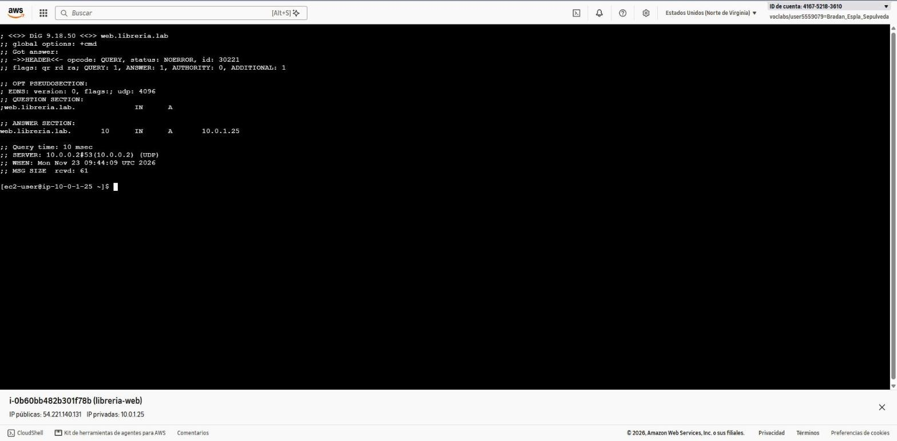

**20 peticiones con `curl`**: responden los dos servidores (10 y 10 en esta tanda). Salen en bloques porque cada respuesta DNS se guarda en caché durante el TTL (10 s), así que durante ~10 peticiones seguidas se usa la misma IP.
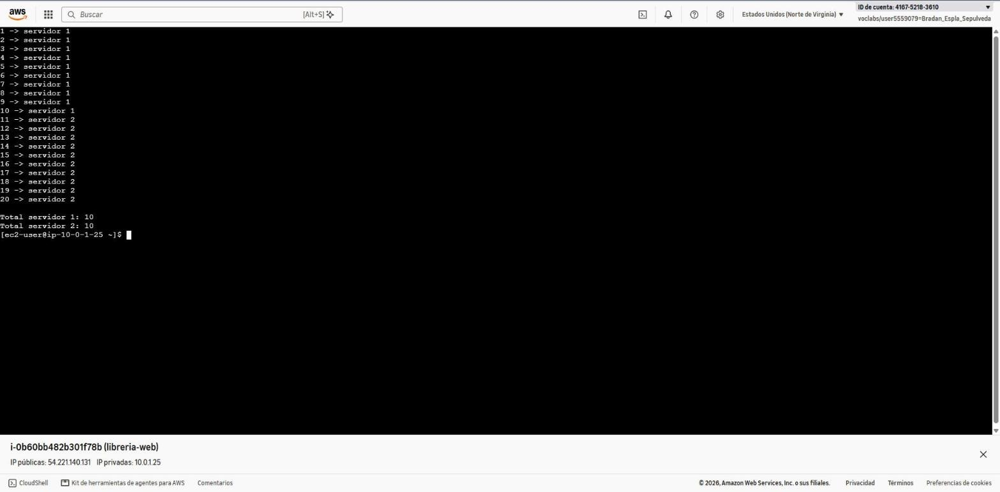

**100 consultas con `dig`**: 81 respuestas al servidor 1 (10.0.1.25) y 19 al servidor 2 (10.0.1.149), muy cerca del 80/20 configurado.
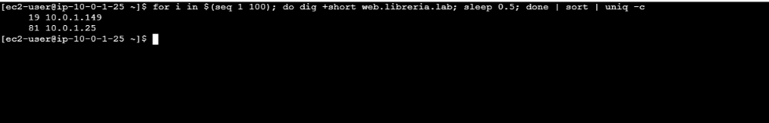

No sale exactamente 16/4 en cada grupo de 20 peticiones porque el peso es una probabilidad, no una secuencia fija. `web.libreria.lab` no se resuelve desde fuera de la VPC porque la zona es privada.

### M2. Presupuesto actualizado

- **Estimación compartida:** https://calculator.aws/#/estimate?id=03ab9a7ec87cf68c7d2a1a59f39f2a2b37ec0807
- **2 × t3.micro 24/7 (16,46 USD) + zona alojada de Route 53 (0,50 USD) = 16,96 USD/mes**, unos 203,52 USD al año. Las consultas DNS de este proyecto son muy pocas y no cambian el total.

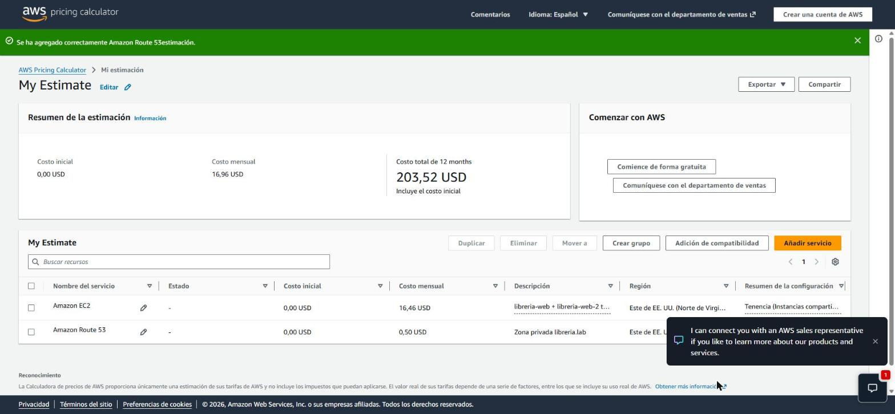

## 4. Nivel avanzado: despliegue con AWS CLI

Scripts en [`scripts/`](scripts/):

- [`desplegar.sh`](scripts/desplegar.sh) repite B2 y B3 reutilizando la red de B1:
  - Obtiene la AMI de Amazon Linux 2023 con `aws ssm get-parameters`.
  - Crea el grupo `libreria-web-cli-sg` con HTTP abierto y SSH solo desde mi IP.
  - Lanza la instancia `libreria-web-cli` con `run-instances`, `user-data1.sh` y las etiquetas.
  - Espera con `aws ec2 wait instance-running` y muestra la URL final.
  - **Si el grupo ya existe, lo reutiliza** en vez de fallar con `InvalidGroup.Duplicate`, así se puede ejecutar varias veces seguidas.
- [`limpiar.sh`](scripts/limpiar.sh) borra lo que crea el script anterior (las instancias `libreria-web-cli` y el grupo `libreria-web-cli-sg`) sin tocar nada del nivel básico.

Se ejecutó en CloudShell, con `user-data1.sh` en la misma carpeta:

```bash
chmod +x desplegar.sh limpiar.sh
./desplegar.sh
```

**Primera ejecución:**
```
IP de administración (SSH): 213.0.87.102/32
AMI: ami-0aacbf72109c53c0c
Grupo de seguridad creado: sg-072d5285b9ed8ff94
Instancia creada: i-09b489d4b9a7f3056
Esperando a que la instancia arranque...
Instancia en ejecución. Espera 1-2 minutos a que nginx se instale.
Abre en el navegador: http://54.163.207.43
```
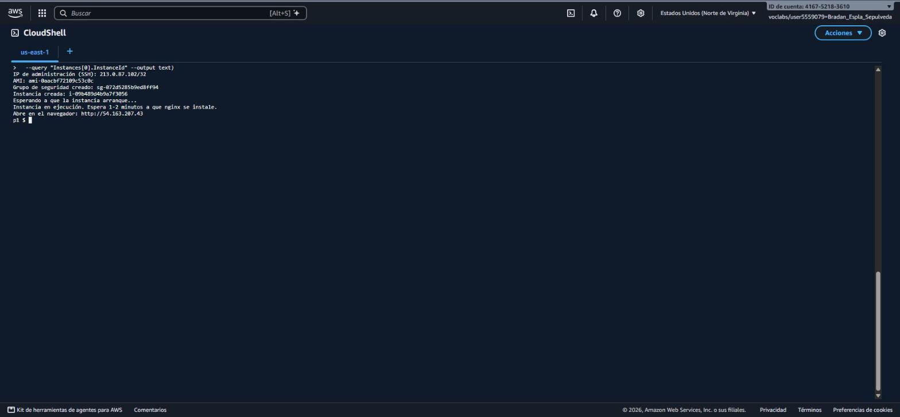

**Segunda ejecución** (el grupo ya existe y se reutiliza):
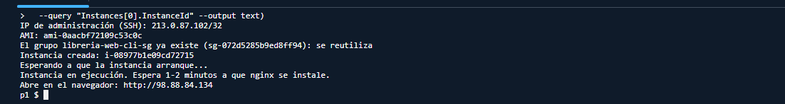

**La web desplegada por el script responde:**
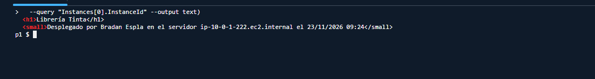

**Limpieza:**
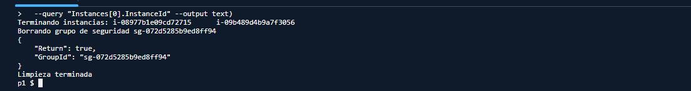

## 5. Uso de IA

- **Herramienta:** Claude (Anthropic). Le pasé el enunciado (PDF y web) y la guía «La terminal de AWS». Me hizo un resumen de lo que había que hacer y una guía paso a paso, preparó los scripts y el README, y con la extensión Claude in Chrome hizo en la consola los pasos de B1–B3, Route 53, la Pricing Calculator, la ejecución del script en CloudShell y la prueba de DNS por EC2 Instance Connect, con las capturas. Yo seguí y revisé cada paso, hice las capturas de las webs en mi navegador, diagnostiqué con `Test-NetConnection` que mi red bloqueaba el puerto 22 y grabé el vídeo.
- **Prompts útiles:**
  1. «quiero que leas también los PDFs y me digas qué tengo que hacer»
  2. «a ver, describe paso por paso»
  3. «¿puedes tomar control de mi PC y hacerlo tú?»
- **Errores de la IA detectados y cómo se corrigieron:**
  1. **IP para el SSH en el script.** La primera versión de `desplegar.sh` calculaba `MI_IP` con `curl https://checkip.amazonaws.com`. Al ejecutarlo en CloudShell eso devuelve la IP de CloudShell (de AWS), no la mía, así que el SSH se habría abierto a la máquina equivocada. Se cambió para escribir la IP a mano (213.0.87.102/32, la que da checkip en mi navegador) y se comprobó en la salida del script y en la regla del grupo.
  2. **Nombre del fichero de user data.** La plantilla del enunciado usa `file://user-data.sh`, pero en la entrega el fichero se llama `user-data1.sh`. Se corrigió la ruta en `desplegar.sh` y se comprobó que la web desplegada por el script mostraba la página correcta.

No he pegado las credenciales de AWS (las claves de acceso de *AWS Details*) en ninguna IA ni las he subido al repositorio. Al principio sí le pasé por error a la IA la clave privada `.pem` de `vockey`; me avisó de que no se debe hacer y desde entonces no la he vuelto a compartir. El `.gitignore` excluye `*.pem` y la carpeta `.aws/` para que no acabe en GitHub.
